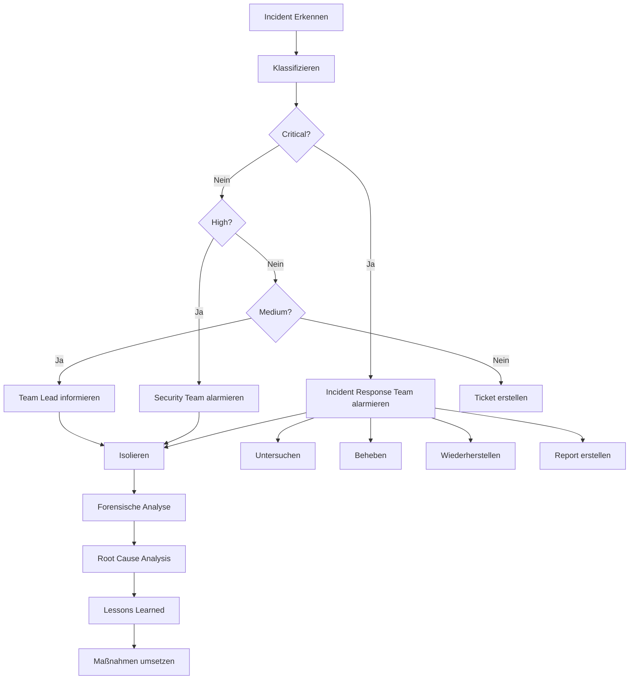

# Sicherheitskonzept

> ⚠️ **Vision / noch nicht implementiert.** Dieses Dokument beschreibt das angestrebte Sicherheitskonzept einer künftigen Enterprise-/Server-Variante (zentrale Authentifizierung, RBAC, Audit-Logs, Zertifizierungen). Diese Komponenten existieren im aktuellen Code **nicht** — UltraCode ist ein lokales Single-User-CLI. Die real implementierten Sicherheitsmaßnahmen (PathGuard gegen Pfad-Traversal/Symlinks, Credential-Bereinigung der Subprozess-Umgebung, Secret-Maskierung) sind im [Haupt-README](../../README.md) und in [`CONTRACTS.md`](../../packages/shared/CONTRACTS.md) beschrieben.

> **Umfassendes Sicherheitskonzept für UltraCode Enterprise - DSGVO, SOC 2, ISO 27001 konform** *(geplant)*

---

## 🔒 Übersicht

Sicherheit ist das oberste Gebot für UltraCode Enterprise. Dieses Dokument beschreibt das umfassende Sicherheitskonzept, das alle Aspekte der Datensicherheit, Zugriffskontrolle, Verschlüsselung und Compliance abdeckt.

---

## 📋 Sicherheitsarchitektur

```
UltraCode Security Architecture
├── Authentication Layer
│   ├── Multi-Factor Authentication (MFA)
│   ├── OAuth 2.0 / OpenID Connect
│   ├── JWT Token Management
│   └── Session Management
│
├── Authorization Layer
│   ├── Role-Based Access Control (RBAC)
│   ├── Attribute-Based Access Control (ABAC)
│   ├── Permission Matrix
│   └── Access Review Engine
│
├── Data Protection Layer
│   ├── Encryption at Rest (AES-256-GCM)
│   ├── Encryption in Transit (TLS 1.3)
│   ├── Field-Level Encryption
│   └── Key Management System (KMS)
│
├── Audit Layer
│   ├── Comprehensive Logging
│   ├── Activity Monitoring
│   ├── Alerting System
│   └── Forensic Analysis
│
└── Network Security Layer
    ├── Firewall Rules
    ├── DDoS Protection
    ├── Network Segmentation
    └── Intrusion Detection/Prevention
```

---

## 🔐 Authentication

### Authentifizierungsmethoden

| **Methode** | **Beschreibung** | **Sicherheitslevel** | **Enterprise** |
|-------------|------------------|---------------------|---------------|
| Local User/Password | Benutzername und Passwort | ⭐⭐ | ✅ |
| OAuth 2.0 | Google, GitHub, Microsoft, etc. | ⭐⭐⭐⭐ | ✅ |
| OpenID Connect | SAML 2.0, Azure AD, Okta | ⭐⭐⭐⭐⭐ | ✅ |
| SAML 2.0 | Enterprise SSO | ⭐⭐⭐⭐⭐ | ✅ |
| LDAP/Active Directory | Unternehmensverzeichnisse | ⭐⭐⭐⭐⭐ | ✅ |
| API Keys | Programmatischer Zugriff | ⭐⭐⭐ | ✅ |
| MFA (TOTP) | Zeitbasierte Einmalpasswörter | ⭐⭐⭐⭐⭐ | ✅ |
| MFA (WebAuthn) | Hardware Security Keys | ⭐⭐⭐⭐⭐ | ✅ |
| MFA (SMS) | SMS-basierte Verifizierung | ⭐⭐⭐ | ✅ |

### OAuth 2.0 Konfiguration

```yaml
# config/auth/oauth.yml
auth:
  providers:
    # Google OAuth
    google:
      clientId: ${GOOGLE_CLIENT_ID}
      clientSecret: ${GOOGLE_CLIENT_SECRET}
      redirectUri: "https://ultracode.yourcompany.com/auth/callback"
      scope: ["openid", "email", "profile"]
      enabled: true

    # GitHub OAuth
    github:
      clientId: ${GITHUB_CLIENT_ID}
      clientSecret: ${GITHUB_CLIENT_SECRET}
      redirectUri: "https://ultracode.yourcompany.com/auth/callback"
      scope: ["user", "repo"]
      enabled: true

    # Microsoft Azure AD
    azure:
      tenantId: ${AZURE_TENANT_ID}
      clientId: ${AZURE_CLIENT_ID}
      clientSecret: ${AZURE_CLIENT_SECRET}
      redirectUri: "https://ultracode.yourcompany.com/auth/callback"
      scope: ["openid", "email", "profile"]
      enabled: true

    # Okta
    okta:
      clientId: ${OKTA_CLIENT_ID}
      clientSecret: ${OKTA_CLIENT_SECRET}
      issuer: "https://{yourOktaDomain}.okta.com"
      redirectUri: "https://ultracode.yourcompany.com/auth/callback"
      enabled: true
```

### SAML 2.0 Konfiguration

```yaml
# config/auth/saml.yml
saml:
  enabled: true
  identityProviders:
    - name: "Company SSO"
      entityId: "https://sso.yourcompany.com/saml/metadata"
      metadataUrl: "https://sso.yourcompany.com/saml/metadata"
      ssoUrl: "https://sso.yourcompany.com/saml/sso"
      certificate: "${SAML_CERTIFICATE}"
      mapping:
        email: "emailAddress"
        username: "nameID"
        groups: "memberOf"
```

### JWT Token Konfiguration

```yaml
# config/auth/jwt.yml
jwt:
  secret: ${JWT_SECRET}
  algorithm: RS256
  expiresIn: 86400 # 24 Stunden
  refreshExpiresIn: 604800 # 7 Tage
  issuer: "ultracode.yourcompany.com"
  audience: "ultracode-api"
  
  # Token Rotation
  rotation:
    enabled: true
    interval: 3600 # 1 Stunde
```

---

## 🛡️ Authorization (RBAC)

### Rollen und Berechtigungen

| **Rolle** | **Beschreibung** | **Berechtigungen** |
|-----------|------------------|-------------------|
| `super-admin` | System-Administrator | Alle Berechtigungen |
| `admin` | Unternehmens-Administrator | Benutzerverwaltung, Projekte, Einstellungen |
| `team-lead` | Team-Leiter | Teamverwaltung, Code-Reviews |
| `developer` | Entwickler | Code-Generierung, Kommentare, Pull Requests |
| `viewer` | Betrachter | Nur Lesen |
| `ai-only` | AI-Only Zugriff | Nur AI-Funktionen |

### RBAC Konfiguration

```yaml
# config/auth/rbac.yml
rbac:
  roles:
    super-admin:
      description: "System-Administrator mit vollen Rechten"
      permissions: ["*"]
      
    admin:
      description: "Unternehmens-Administrator"
      permissions:
        - "user:create"
        - "user:read"
        - "user:update"
        - "user:delete"
        - "team:create"
        - "team:read"
        - "team:update"
        - "team:delete"
        - "project:create"
        - "project:read"
        - "project:update"
        - "project:delete"
        - "settings:read"
        - "settings:update"
        - "ai:full-access"

    team-lead:
      description: "Team-Leiter"
      permissions:
        - "user:read"
        - "team:read"
        - "team:update"
        - "project:create"
        - "project:read"
        - "project:update"
        - "code:write"
        - "code:review"
        - "ai:full-access"

    developer:
      description: "Entwickler"
      permissions:
        - "user:read"
        - "team:read"
        - "project:read"
        - "code:read"
        - "code:write"
        - "code:comment"
        - "ai:full-access"

    viewer:
      description: "Betrachter"
      permissions:
        - "user:read"
        - "team:read"
        - "project:read"
        - "code:read"
        - "ai:read-only"

    ai-only:
      description: "AI-Only Zugriff"
      permissions:
        - "ai:full-access"

  # Standardrolle für neue Benutzer
  defaultRole: "developer"
  
  # Rollenhierarchie (höhere Rollen erben Berechtigungen)
  hierarchy:
    - "super-admin"
    - "admin"
    - "team-lead"
    - "developer"
    - "viewer"
    - "ai-only"
```

### Berechtigungsmatrix

| **Ressource** | **super-admin** | **admin** | **team-lead** | **developer** | **viewer** | **ai-only** |
|---------------|----------------|-----------|---------------|---------------|------------|-------------|
| Benutzer verwalten | ✅ | ✅ | ❌ | ❌ | ❌ | ❌ |
| Teams verwalten | ✅ | ✅ | ✅ | ❌ | ❌ | ❌ |
| Projekte verwalten | ✅ | ✅ | ✅ | ❌ | ❌ | ❌ |
| Code schreiben | ✅ | ✅ | ✅ | ✅ | ❌ | ❌ |
| Code lesen | ✅ | ✅ | ✅ | ✅ | ✅ | ❌ |
| Code-Reviews | ✅ | ✅ | ✅ | ✅ | ❌ | ❌ |
| AI verwenden | ✅ | ✅ | ✅ | ✅ | ✅ | ✅ |
| Einstellungen ändern | ✅ | ✅ | ❌ | ❌ | ❌ | ❌ |
| System-Logs | ✅ | ❌ | ❌ | ❌ | ❌ | ❌ |

---

## 🔐 Verschlüsselung

### Verschlüsselungsstandards

| **Daten** | **Algorithm** | **Schlüssellänge** | **Beschreibung** |
|-----------|---------------|-------------------|------------------|
| Daten im Ruhezustand | AES-256-GCM | 256-bit | Datenbank, Dateien, Backups |
| Daten im Transit | TLS 1.3 | 256-bit | Alle Netzwerkkommunikation |
| Passwörter | Argon2id | 128-bit | Passwort-Hashing |
| JWT Tokens | RS256 | 2048-bit | Token-Signierung |
| Datenbankfelder | AES-256-CBC | 256-bit | Sensible Felder |

### Verschlüsselungskonfiguration

```yaml
# config/security/encryption.yml
encryption:
  # Master Encryption Key (wird für alle anderen Schlüssel verwendet)
  masterKey: ${MASTER_ENCRYPTION_KEY}
  
  # Algorithmen
  algorithm: AES-256-GCM
  hashAlgorithm: SHA-512
  
  # Datenbankverschlüsselung
  database:
    enabled: true
    fields:
      - "users.password"
      - "users.email"
      - "projects.name"
      - "code.content"
    keyRotation: 365 # Tage
  
  # Dateisystemverschlüsselung
  filesystem:
    enabled: true
    directory: "./data/encrypted"
    key: ${FILESYSTEM_ENCRYPTION_KEY}
  
  # TLS Konfiguration
  tls:
    certificate: "./certs/server.crt"
    privateKey: "./certs/server.key"
    caCertificate: "./certs/ca.crt"
    minVersion: TLSv1_3
    ciphers:
      - TLS_AES_256_GCM_SHA384
      - TLS_CHACHA20_POLY1305_SHA256
      - TLS_AES_128_GCM_SHA256
```

### Key Management System (KMS)

```yaml
# config/security/kms.yml
kms:
  provider: aws-kms # oder local, hashicorp-vault, azure-key-vault
  
  aws:
    region: eu-central-1
    keyId: ${AWS_KMS_KEY_ID}
    accessKey: ${AWS_ACCESS_KEY_ID}
    secretKey: ${AWS_SECRET_ACCESS_KEY}
  
  local:
    enabled: false # Nur für Entwicklung
    keyPath: "./keys"
  
  hashicorp:
    url: "https://vault.yourcompany.com:8200"
    token: ${VAULT_TOKEN}
    keyPath: "secret/ultracode"
  
  # Key Rotation
  rotation:
    enabled: true
    interval: 30 # Tage
    notifyBefore: 7 # Tage
```

---

## 📝 Audit & Logging

### Audit Logging Konfiguration

```yaml
# config/security/audit.yml
audit:
  enabled: true
  
  # Was wird protolliert
  log:
    authentication:
      success: true
      failure: true
      mfa: true
    authorization:
      permissionCheck: true
      accessDenied: true
    data:
      create: true
      read: true
      update: true
      delete: true
    ai:
      prompt: true
      response: true
      model: true
    system:
      startup: true
      shutdown: true
      errors: true
  
  # Speicher
  storage:
    database: true
    filesystem: true
    path: "./logs/audit"
    retention: 365 # Tage
  
  # Export
  export:
    splunk: false
    elk: false
    siem: true
    siemUrl: "https://siem.yourcompany.com/api/logs"
    siemKey: ${SIEM_API_KEY}
```

### Log-Format

**Beispiel Audit-Log-Eintrag:**

```json
{
  "timestamp": "2026-06-11T12:00:00.000Z",
  "eventId": "550e8400-e29b-41d4-a716-446655440000",
  "userId": "user_123",
  "username": "alice",
  "email": "alice@yourcompany.com",
  "ipAddress": "192.168.1.100",
  "userAgent": "Mozilla/5.0 (Macintosh; Intel Mac OS X 10_15_7)",
  "action": "code:create",
  "resource": "project_456/file_789",
  "resourceType": "code",
  "result": "success",
  "metadata": {
    "fileName": "app.js",
    "language": "javascript",
    "linesChanged": 42,
    "aiModel": "gpt-4",
    "sessionId": "session_abc123"
  },
  "duration": 1250
}
```

### Alerting

```yaml
# config/security/alerts.yml
alerts:
  enabled: true
  
  rules:
    - name: "Failed Authentication"
      condition: "auth.failure > 5 in 5 minutes"
      severity: HIGH
      notify:
        - email: security@yourcompany.com
        - slack: "#security-alerts"
        - pagerduty: true
      
    - name: "Unauthorized Access Attempt"
      condition: "auth.access_denied > 3 in 1 minute"
      severity: CRITICAL
      notify:
        - email: security@yourcompany.com
        - slack: "#security-alerts"
        - pagerduty: true
        - sms: "+49123456789"
      
    - name: "Data Export"
      condition: "data.delete or data.export"
      severity: MEDIUM
      notify:
        - email: security@yourcompany.com
      
    - name: "AI Model Change"
      condition: "ai.model_changed"
      severity: LOW
      notify:
        - email: it@yourcompany.com
```

---

## 🌐 Netzwerksicherheit

### Firewall Regeln

```yaml
# config/security/firewall.yml
firewall:
  enabled: true
  
  inbound:
    - port: 80
      protocol: TCP
      action: redirect-to-443
      
    - port: 443
      protocol: TCP
      action: allow
      sources: ["0.0.0.0/0"]
      
    - port: 22
      protocol: TCP
      action: allow
      sources: ["192.168.1.0/24", "10.0.0.0/8"]
      
    - port: 3000
      protocol: TCP
      action: allow
      sources: ["192.168.1.0/24"]
      
    - port: 5432
      protocol: TCP
      action: allow
      sources: ["192.168.1.100"] # Nur Datenbank-Server
      
    - port: 6379
      protocol: TCP
      action: allow
      sources: ["192.168.1.100"] # Nur Redis-Server
      
  outbound:
    - action: allow
      destinations: ["0.0.0.0/0"]
      ports: [80, 443] # HTTP/HTTPS
      
    - action: allow
      destinations: ["api.openai.com"]
      ports: [443]
      
    - action: allow
      destinations: ["api.anthropic.com"]
      ports: [443]
      
    - action: allow
      destinations: ["api.mistral.ai"]
      ports: [443]
      
    - action: allow
      destinations: ["smtp.yourcompany.com"]
      ports: [587]
      
    - action: deny
      destinations: ["0.0.0.0/0"]
```

### DDoS Schutz

```yaml
# config/security/ddos.yml
ddos:
  enabled: true
  
  rateLimiting:
    enabled: true
    requestsPerMinute: 1000
    burstRequests: 50
    
  ipBlocking:
    enabled: true
    maxAttempts: 100
    blockDuration: 3600 # 1 Stunde
    
  geoBlocking:
    enabled: false
    blockedCountries: ["CN", "RU", "KP"]
    
  cloudflare:
    enabled: true
    zoneId: ${CLOUDFLARE_ZONE_ID}
    apiKey: ${CLOUDFLARE_API_KEY}
```

---

## 🏥 Compliance

### DSGVO (General Data Protection Regulation)

**Umsetzung in UltraCode:**

```yaml
# config/compliance/gdpr.yml
gdpr:
  enabled: true
  
  dataSubjectRights:
    rightToAccess: true
    rightToRectification: true
    rightToErasure: true
    rightToRestriction: true
    rightToPortability: true
    rightToObjection: true
  
  dataRetention:
    enabled: true
    defaults:
      auditLogs: 365 # Tage
      userData: 2555 # 7 Jahre
      codeData: 2555 # 7 Jahre
      temporaryData: 30 # Tage
    
  dataEncryption:
    enabled: true
    personalData: true
    sensitiveData: true
    
  consentManagement:
    enabled: true
    required: true
    version: "v2.0"
    
  privacyPolicy:
    url: "https://ultracode.yourcompany.com/privacy"
    lastUpdated: "2026-06-11"
```

### SOC 2 Type II

**Kontrollen:**

- **Security**: Zugriffskontrolle, Verschlüsselung, Netzwerksicherheit
- **Availability**: Hochverfügbarkeit, Backups, Disaster Recovery
- **Processing Integrity**: Datenvalidierung, Audit-Trails
- **Confidentiality**: Verschlüsselung, Zugriffskontrolle, NDAs
- **Privacy**: DSGVO-Konformität, Datenminimierung

### ISO 27001

**Implementierte Kontrollen:**

- A.5 - Informationssicherheitspolitik
- A.6 - Organisation der Informationssicherheit
- A.7 - Personalsicherheit
- A.8 - Asset-Management
- A.9 - Zugriffskontrolle
- A.10 - Kryptographie
- A.11 - Physische Sicherheit
- A.12 - Betriebssicherheit
- A.13 - Netzwerksicherheit
- A.14 - Systemerwerb und -entwicklung
- A.15 - Lieferantenbeziehungen
- A.16 - Informationssicherheitsvorfälle
- A.17 - Informationssicherheitsaspekte des Business Continuity Managements
- A.18 - Compliance

---

## 🔧 Sicherheits-Checkliste

### [ ] Vor der Bereitstellung

- [ ] Alle Geheimnisse in Secrets-Manager gespeichert
- [ ] TLS-Zertifikate installiert und gültig
- [ ] Firewall-Regeln konfiguriert
- [ ] DDoS-Schutz aktiviert
- [ ] Audit-Logging aktiviert
- [ ] Backup-Strategie definiert
- [ ] Incident-Response-Plan erstellt
- [ ] Penetrationstest durchgeführt

### [ ] Nach der Bereitstellung

- [ ] Alle Dienste laufen
- [ ] Monitoring und Alerting funktionieren
- [ ] Logs werden korrekt gespeichert
- [ ] Backups werden regelmäßig erstellt
- [ ] Sicherheitsupdates werden angewendet
- [ ] Benutzer und Rollen richtig konfiguriert

### [ ] Regelmäßige Wartung

- [ ] Wöchentlich: Log-Überprüfung
- [ ] Monatlich: Sicherheitsupdates
- [ ] Quartalsweise: Penetrationstest
- [ ] Jährlich: Compliance-Audit

---

## 🚨 Incident Response

### Incident-Klassifizierung

| **Severität** | **Beschreibung** | **Reaktionszeit** |
|---------------|------------------|-------------------|
| **Critical** | Systemkompromittierung, Datendiebstahl | sofort |
| **High** | Erfolglose Angriffe, Sicherheitslücke | < 1 Stunde |
| **Medium** | Verdächtige Aktivitäten | < 4 Stunden |
| **Low** | Minor Sicherheitsvorfälle | < 24 Stunden |

### Incident-Response-Prozess



### Kontakt im Notfall

| **Kontakt** | **Verantwortlichkeit** | **Erreichbarkeit** |
|-------------|------------------------|--------------------|
| CISO | Security Strategy | 24/7 |
| Security Team | Incident Response | 24/7 |
| DevOps Team | System-Wiederherstellung | 24/7 |
| Legal Team | Compliance, DSGVO | Bürozeiten |

---

## 🔗 Nächste Schritte

- [➡️ Selbsthosting](./self-hosting.md)
- [➡️ Team-Zusammenarbeit](./team-collaboration.md)
- [➡️ API-Dokumentation](../REFERENCE/api.md)

---

## 📞 Support

- **Sicherheitsvorfall melden**: security@ultracode.ai
- **Compliance-Fragen**: compliance@ultracode.ai
- **Allgemeiner Support**: support@ultracode.ai

© 2026 UltraCode Team
