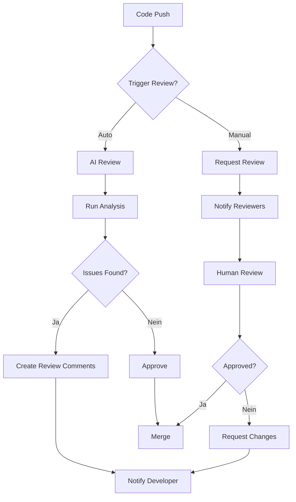

# Team-Zusammenarbeit

> ⚠️ **Vision / noch nicht implementiert.** Multi-User-Zusammenarbeit, geteilte Projekt-Teams und eine gemeinsame Wissensdatenbank sind **Roadmap**. Der aktuelle Code ist Single-User und lokal; es existiert kein Server, der mehrere Nutzer verbindet. Verbindlich ist die [CLI-Referenz](../REFERENCE/cli-commands.md).

> **Kollaborative Entwicklung mit UltraCode - Multi-User, Projekt-Teams, Wissensdatenbank** *(geplant)*

---

## 👥 Übersicht

UltraCode Enterprise ermöglicht nahtlose Zusammenarbeit in Teams jeder Größe. Mit Multi-User-Unterstützung, Projektorganisation und einer gemeinsamen Wissensdatenbank wird die Entwicklung produktiver und effizienter.

---

## 📊 Architektur

```
UltraCode Team Collaboration Architecture
├── User Management
│   ├── User Profiles
│   ├── User Preferences
│   └── User Sessions
│
├── Team Management
│   ├── Teams (Group of Users)
│   ├── Team Roles
│   ├── Team Settings
│   └── Team Analytics
│
├── Project Management
│   ├── Projects (Workspace)
│   ├── Project Members
│   ├── Project Permissions
│   └── Project Settings
│
├── Knowledge Base
│   ├── Shared Context
│   ├── Team Knowledge
│   ├── Project Knowledge
│   └── Learning & Adaptation
│
└── Collaboration Features
    ├── Code Reviews
    ├── Pair Programming
    ├── Shared Sessions
    └── Mentions & Notifications
```

---

## 👤 Benutzerverwaltung

### Benutzer erstellen

```bash
# CLI - Benutzer erstellen
ultracode user create alice \
  --email alice@yourcompany.com \
  --password secure-password \
  --first-name Alice \
  --last-name Smith \
  --role developer

# Mit OAuth (automatisch bei erstem Login)
# Keine manuelle Erstellung nötig

# Batch Import (CSV)
ultracode user import users.csv
```

**CSV-Format für Batch-Import:**
```csv
email,firstName,lastName,role,team,manager
alice@yourcompany.com,Alice,Smith,developer,Dev Team A,bob@yourcompany.com
bob@yourcompany.com,Bob,Johnson,team-lead,Dev Team A,
bob@yourcompany.com
charlie@yourcompany.com,Charlie,Brown,developer,Dev Team A,bob@yourcompany.com
```

### Benutzerprofile

```yaml
# Beispiel Benutzerprofil
user:
  id: user_123
  email: alice@yourcompany.com
  username: alice
  firstName: Alice
  lastName: Smith
  displayName: Alice Smith
  role: developer
  
  preferences:
    theme: dark
    language: en
    fontSize: 14
    editor:
      font: Fira Code
      tabSize: 2
      lineHeight: 1.5
    ai:
      model: gpt-4
      temperature: 0.7
      maxTokens: 4096
      
  settings:
    notifications:
      email: true
      desktop: true
      slack: true
      
    privacy:
      showEmail: true
      showOnlineStatus: true
      
    shortcuts:
      acceptSuggestion: "Tab"
      nextSuggestion: "Alt+]"
      previousSuggestion: "Alt["
      
  metadata:
    createdAt: "2026-06-11T10:00:00.000Z"
    lastLogin: "2026-06-11T12:00:00.000Z"
    loginCount: 42
    projectsContributed: 15
    codeReviews: 23
    suggestionsAccepted: 89
```

### Benutzer CLI-Kommandos

```bash
# Benutzer auflisten
ultracode user list
ultracode user list --role developer
ultracode user list --team "Dev Team A"

# Benutzer anzeigen
ultracode user show alice
ultracode user show alice@yourcompany.com

# Benutzer aktualisieren
ultracode user update alice --first-name Alice --last-name Smith

# Benutzer deaktivieren
ultracode user disable alice

# Benutzer löschen
ultracode user delete alice --force

# Benutzer suchen
ultracode user search "Alice"
ultracode user search --email "@yourcompany.com"
```

---

## 👥 Team-Verwaltung

### Teams erstellen

```bash
# Team erstellen
ultracode team create "Dev Team A" \
  --description "Backend Development Team" \
  --lead bob@yourcompany.com \
  --members alice@yourcompany.com,charlie@yourcompany.com,dave@yourcompany.com

# Team aus Datei erstellen
ultracode team create "Data Team" --file team-data.json
```

**team-data.json:**
```json
{
  "name": "Data Team",
  "description": "Data Science and Analytics Team",
  "lead": "eve@yourcompany.com",
  "members": [
    "eve@yourcompany.com",
    "frank@yourcompany.com",
    "grace@yourcompany.com"
  ],
  "permissions": {
    "projects": ["data-platform", "analytics-dashboard"],
    "ai": {
      "models": ["gpt-4", "claude-3-sonnet"],
      "maxTokens": 8192
    }
  },
  "settings": {
    "defaultProject": "data-platform",
    "notificationChannel": "#data-team"
  }
}
```

### Team-Rollen

| **Rolle** | **Beschreibung** | **Verantwortlichkeiten** |
|-----------|------------------|-------------------------|
| `team-lead` | Team-Leiter | Team-Management, Code-Reviews, Priorisierung |
| `senior-dev` | Senior-Entwickler | Architektur, Mentoring, komplexe Aufgaben |
| `developer` | Entwickler | Feature-Entwicklung, Bugfixes |
| `junior-dev` | Junior-Entwickler | Einfache Aufgaben, Lernen |
| `analyst` | Analyst | Analyse, Spezifikation |
| `tester` | Tester | Qualitätssicherung, Tests |

### Team CLI-Kommandos

```bash
# Teams auflisten
ultracode team list
ultracode team list --search "Dev"

# Team anzeigen
ultracode team show "Dev Team A"
ultracode team show "Dev Team A" --members
ultracode team show "Dev Team A" --projects

# Team aktualisieren
ultracode team update "Dev Team A" \
  --name "Dev Team Alpha" \
  --lead bob@yourcompany.com

# Team-Mitglied hinzufügen
ultracode team add "Dev Team A" alice@yourcompany.com

# Team-Mitglied entfernen
ultracode team remove "Dev Team A" alice@yourcompany.com

# Team löschen
ultracode team delete "Dev Team A" --force
```

---

## 📁 Projektverwaltung

### Projekte erstellen

```bash
# Projekt erstellen
ultracode project create "New Product" \
  --description "New product development" \
  --team "Dev Team A" \
  --lead bob@yourcompany.com \
  --visibility private \
  --template react-typescript

# Projekt mit Konfiguration
ultracode project create "API Service" --file project-config.yml
```

**project-config.yml:**
```yaml
name: "API Service"
description: "REST API for new microservice"
team: "Dev Team A"
lead: bob@yourcompany.com
visibility: private

settings:
  language: typescript
  framework: express
  database: postgresql
  ai:
    model: gpt-4
    temperature: 0.3
    maxTokens: 8192
  
  code:
    lint: true
    format: true
    tests: true
    
  integration:
    ci: github-actions
    cd: aws-code-deploy
    monitoring: prometheus

members:
  - user: alice@yourcompany.com
    role: developer
  - user: bob@yourcompany.com
    role: team-lead
  - user: charlie@yourcompany.com
    role: developer

environments:
  - name: development
    branch: dev
    url: https://dev.api.yourcompany.com
  - name: staging
    branch: staging
    url: https://staging.api.yourcompany.com
  - name: production
    branch: main
    url: https://api.yourcompany.com
```

### Projekt-Sichtbarkeit

| **Sichtbarkeit** | **Beschreibung** | **Zugang** |
|-----------------|------------------|------------|
| `private` | Nur Team-Mitglieder | Eingeladene Benutzer |
| `team` | Alle Team-Mitglieder | Team-weite Sichtbarkeit |
| `organization` | Alle Benutzer der Organisation | Unternehmensweit |
| `public` | Öffentlich zugänglich | Jeder (mit Berechtigung) |

### Projekt CLI-Kommandos

```bash
# Projekte auflisten
ultracode project list
ultracode project list --team "Dev Team A"
ultracode project list --user alice@yourcompany.com

# Projekt anzeigen
ultracode project show "New Product"
ultracode project show "New Product" --files
ultracode project show "New Product" --members

# Projekt aktualisieren
ultracode project update "New Product" \
  --description "Enhanced product with AI features" \
  --visibility team

# Mitglied zu Projekt hinzufügen
ultracode project add "New Product" alice@yourcompany.com --role developer

# Mitglied aus Projekt entfernen
ultracode project remove "New Product" alice@yourcompany.com

# Projekt löschen
ultracode project delete "New Product" --force
```

---

## 🧠 Wissensdatenbank

### Übersicht

Die UltraCode Wissensdatenbank ist eine gemeinsame Lernumgebung für Teams. Sie speichert:

- **Koden-Konventionen**: Team-spezifische Codierungsstandards
- **Projekt-Kontext**: Technische Details und Hintergrundwissen
- **Lösungen**: Häufige Probleme und deren Lösungen
- **Best Practices**: Bewährte Methoden und Patterns
- **Lernfortschritt**: Wie das AI-Modell das Team besser versteht

### Wissensdatenbank-Struktur

```
Knowledge Base/
├── Global/
│   ├── Code Conventions/
│   │   ├── naming.md
│   │   ├── style.md
│   │   └── patterns.md
│   ├── Best Practices/
│   │   ├── security.md
│   │   ├── performance.md
│   │   └── testing.md
│   └── Architecture/
│       ├── microservices.md
│       └── database.md
│
├── Team/Dev Team A/
│   ├── Project Context/
│   │   ├── new-product.md
│   │   └── api-service.md
│   ├── Solutions/
│   │   ├── problem-1.md
│   │   └── problem-2.md
│   └── Learning/
│       └── team-patterns.md
│
└── User/alice/
    └── Preferences/
        ├── coding-style.md
        └── preferences.md
```

### Wissensdatenbank-Verwaltung

```bash
# Wissen hinzufügen
ultracode knowledge add "TypeScript Best Practices" \
  --content "Always use interfaces for type definitions..." \
  --category "Best Practices" \
  --scope global \
  --team "Dev Team A"

# Wissen durchsuchen
ultracode knowledge search "TypeScript"
ultracode knowledge search "performance optimization"

# Wissen aktualisieren
ultracode knowledge update "TypeScript Best Practices" \
  --content "Updated content..."

# Wissen löschen
ultracode knowledge delete "TypeScript Best Practices"

# Wissen exportieren
ultracode knowledge export --format markdown > knowledge-base.md

# Wissen importieren
ultracode knowledge import knowledge-base.md
```

### AI-Lernprozess

Die Wissensdatenbank lernt kontinuierlich von der Team-Zusammenarbeit:

```
AI Learning Cycle:
1. Team arbeitet mit UltraCode
   └── Code generiert
   └── Feedback gegeben
   └── Lösungen akzeptiert
   
2. UltraCode analysiert:
   └── Code-Muster
   └── Feedback-Muster
   └── Lösungsmuster
   
3. UltraCode aktualisiert:
   └── Team-Kontext
   └── Code-Vorlagen
   └── Vorschlagsqualität
   
4. Team profitiert:
   └── Bessere Vorschläge
   └── Schnellere Entwicklung
   └── Konsistenter Code
```

### Kontext-Verwaltung

```yaml
# config/knowledge/context.yml
context:
  global:
    company:
      name: "Your Company"
      industry: "Software Development"
      technologies: ["TypeScript", "React", "Node.js", "PostgreSQL"]
      
    conventions:
      code:
        style: "Airbnb"
        linter: "ESLint"
        formatter: "Prettier"
        
      documentation:
        format: "Markdown"
        location: "/docs"
        
      testing:
        framework: "Jest"
        coverage: 80
        
  team:
    "Dev Team A":
      domain: "Backend Services"
      stack: ["Node.js", "Express", "TypeScript", "PostgreSQL"]
      patterns:
        - "Repository Pattern"
        - "Service Layer"
        - "Dependency Injection"
      
      conventions:
        api:
          rest: true
          graphql: false
          versioning: path
          
        database:
          orm: "Prisma"
          naming: "snake_case"
          
  project:
    "New Product":
      description: "Next generation SaaS product"
      techStack: ["React", "TypeScript", "Node.js", "MongoDB"]
      architecture: "Microservices"
      deployment: "AWS ECS"
      
      context:
        - "User authentication via JWT"
        - "Multi-tenant architecture"
        - "REST API with GraphQL extensions"
```

---

## 🔍 Code Reviews

### AI-gestützte Code-Reviews

UltraCode bietet automatisierte Code-Reviews mit:

- **Qualitätschecks**: Code-Qualität nach Best Practices
- **Sicherheitschecks**: Sicherheitslücken erkennen
- **Performance-Checks**: Performance-Probleme identifizieren
- **Konsistenzchecks**: Team-Konventionen einhalten
- **Komplexitätsanalyse**: Code-Komplexität bewerten

### Code-Review-Prozess



### Code-Review CLI

```bash
# Code-Review anfordern
ultracode review request --project "New Product" --branch feature/new-api

# Code-Review durchführen
ultracode review run --pull-request 123

# Review-Ergebnisse anzeigen
ultracode review show 123

# Review-Kommentare hinzufügen
ultracode review comment 123 --line 42 --message "Consider using TypeScript interface here"

# Review genehmigen
ultracode review approve 123

# Review ablehnen
ultracode review reject 123 --message "Please fix the security issues"
```

### Review-Konfiguration

```yaml
# config/review.yml
review:
  enabled: true
  
  autoReview:
    enabled: true
    triggers:
      - pull-request
      - push-to-main
      
  checks:
    quality:
      enabled: true
      severity: warning
      rules:
        - max-line-length: 120
        - max-function-length: 50
        - max-file-length: 500
        
    security:
      enabled: true
      severity: error
      rules:
        - no-hardcoded-secrets
        - sql-injection
        - xss-protection
        - csrf-protection
        
    performance:
      enabled: true
      severity: warning
      rules:
        - no-nested-loops: 3
        - max-query-complexity: 10
        - memory-leak-detection
        
    consistency:
      enabled: true
      severity: info
      rules:
        - naming-conventions
        - import-order
        - code-style
        
  qualityGates:
    code: 80
    security: 100
    performance: 90
    
  reviewers:
    required: 1
    teamLeadRequired: true
    seniorDevRequired: false
```

---

## 💬 Kommunikation & Benachrichtigungen

### Benachrichtigungskanäle

| **Kanal** | **Beschreibung** | **Verwendungszweck** |
|-----------|------------------|---------------------|
| E-Mail | Traditionelle E-Mail | Wichtige Updates, tägliche Zusammenfassungen |
| Slack | Sofortige Nachrichten | Echtzeit-Kollaboration, Benachrichtigungen |
| Microsoft Teams | Unternehmens-Chat | Team-Kommunikation |
| Discord | Community-Chat | Offizielle UltraCode-Community |
| Desktop | System-Benachrichtigungen | Sofortige Alerts |
| Mobile Push | Mobile App | Dringende Benachrichtigungen |

### Benachrichtigungs-Konfiguration

```yaml
# config/notifications.yml
notifications:
  enabled: true
  
  channels:
    email:
      enabled: true
      smtp:
        host: smtp.yourcompany.com
        port: 587
        secure: true
        auth:
          user: ${EMAIL_USER}
          pass: ${EMAIL_PASSWORD}
      
    slack:
      enabled: true
      webhook: ${SLACK_WEBHOOK_URL}
      channel: "#ultracode-alerts"
      
    teams:
      enabled: false
      webhook: ${TEAMS_WEBHOOK_URL}
      
    discord:
      enabled: false
      webhook: ${DISCORD_WEBHOOK_URL}
      
    desktop:
      enabled: true
      
    mobile:
      enabled: false
      
  triggers:
    - event: "review.requested"
      channels: ["email", "slack"]
      
    - event: "review.completed"
      channels: ["email", "slack"]
      
    - event: "merge.conflict"
      channels: ["email", "slack", "desktop"]
      
    - event: "build.failed"
      channels: ["slack", "desktop"]
      
    - event: "build.success"
      channels: ["slack"]
      
    - event: "ai.model_changed"
      channels: ["email"]
      
    - event: "security.alert"
      channels: ["email", "slack", "desktop", "mobile"]
```

### Benachrichtigungs-CLI

```bash
# Benachrichtigungen anzeigen
ultracode notification list
ultracode notification list --unread

# Benachrichtigung anzeigen
ultracode notification show 123

# Benachrichtigung als gelesen markieren
ultracode notification mark 123 --read

# Alle Benachrichtigungen als gelesen markieren
ultracode notification mark all --read

# Benachrichtigungs-Einstellungen
ultracode notification settings
```

---

## 👥 Kollaborative Sessions

### Pair Programming

```bash
# Session starten
ultracode session start --type pair --project "New Product"

# Session beitreten
ultracode session join session_123

# Session verlassen
ultracode session leave session_123

# Session beenden
ultracode session end session_123

# Aktive Sessions anzeigen
ultracode session list
```

### Shared Sessions (Live-Kollaboration)

- **Echtzeit-Code-Bearbeitung**: Mehrere Benutzer arbeiten gleichzeitig
- **Shared Cursor**: Anderen Benutzern folgen
- **Chat**: Integrierter Session-Chat
- **Screen Sharing**: Bildschirm teilen
- **Voice Chat**: Sprachkommunikation

```bash
# Shared Session starten
ultracode session start --type shared --users alice,bob,charlie

# Session aufzeichnen
ultracode session start --type shared --record

# Session-Aufzeichnung abspielen
ultracode session play session_123
```

---

## 📊 Analytics & Reporting

### Team-Analytics

```bash
# Team-Statistiken
ultracode analytics team "Dev Team A"

# Team-Produktivität
ultracode analytics team "Dev Team A" --productivity

# Team-Code-Qualität
ultracode analytics team "Dev Team A" --quality
```

**Beispiel Team-Analytics:**

```json
{
  "team": "Dev Team A",
  "period": "last-30-days",
  "metrics": {
    "codeGenerated": 12543,
    "linesOfCode": 45678,
    "filesCreated": 234,
    "filesModified": 456,
    "codeReviews": 89,
    "suggestionsAccepted": 345,
    "suggestionsRejected": 45,
    "aiRequests": 2345,
    "aiTokensUsed": 1234567,
    "activeDays": 25,
    "averageSessionDuration": 1245,
    "productivityScore": 87.5
  },
  "quality": {
    "codeQuality": 92.3,
    "securityScore": 98.7,
    "performanceScore": 89.2,
    "consistencyScore": 95.1
  },
  "members": [
    {
      "user": "alice@yourcompany.com",
      "codeGenerated": 3456,
      "linesOfCode": 12345,
      "productivity": 92.3,
      "quality": 95.6
    },
    {
      "user": "bob@yourcompany.com",
      "codeGenerated": 4567,
      "linesOfCode": 15678,
      "productivity": 89.1,
      "quality": 91.2
    }
  ]
}
```

### Projekt-Analytics

```bash
# Projekt-Statistiken
ultracode analytics project "New Product"

# Projekt-Fortschritt
ultracode analytics project "New Product" --progress

# Projekt-Qualität
ultracode analytics project "New Product" --quality
```

---

## 🔗 Nächste Schritte

- [➡️ Selbsthosting](./self-hosting.md)
- [➡️ Sicherheitskonfiguration](./security.md)
- [➡️ API-Dokumentation](../REFERENCE/api.md)

---

## 📞 Support

- **Team-Management**: team-support@ultracode.ai
- **Projekt-Fragen**: projects@ultracode.ai
- **Allgemeiner Support**: support@ultracode.ai

© 2026 UltraCode Team
